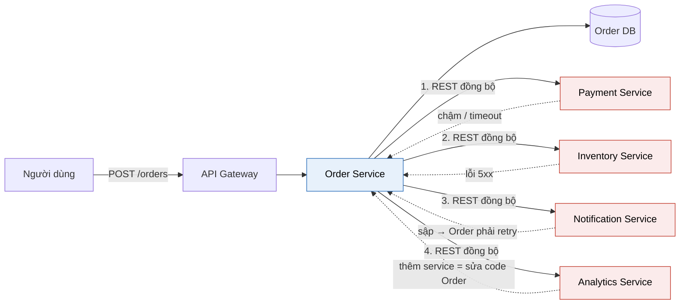
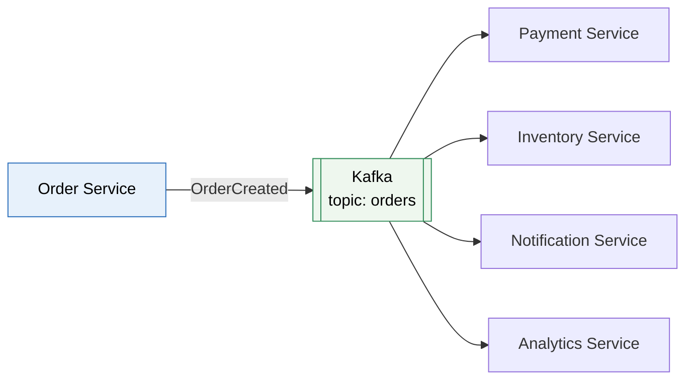
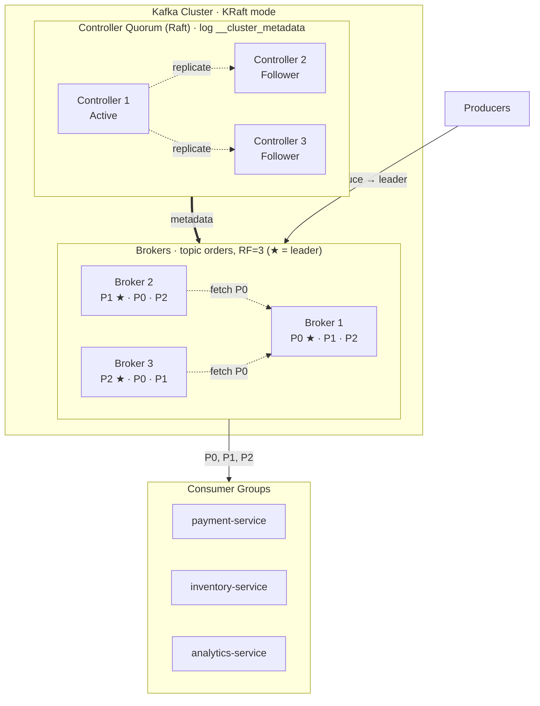
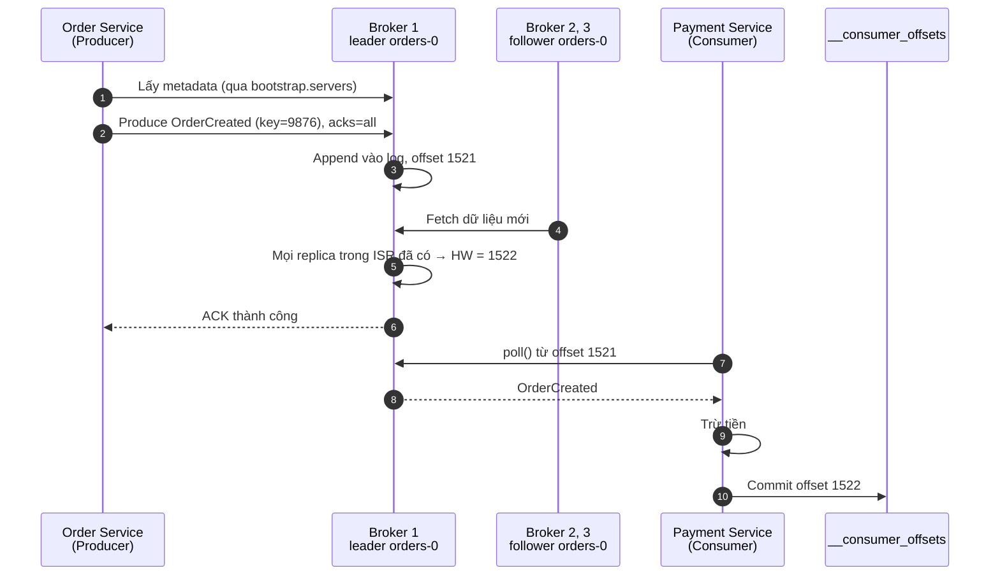

> **Bài viết dựa trên Apache Kafka 4.x** (chế độ KRaft, không còn ZooKeeper).
> **Đối tượng:** backend developer đã quen REST/microservice, muốn hiểu Kafka hoạt động bên trong ra sao.
> **Sau bài này bạn sẽ nắm được:** Kafka giải quyết vấn đề gì, các thành phần trong cluster, hành trình của một message từ lúc gửi đến lúc được đọc, và khi nào Kafka *thực sự* không mất dữ liệu.

---

## 1. Ngày Flash Sale, Order Service đứng hình

20:00, Flash Sale bắt đầu. Lượng đơn tăng gấp 20 lần bình thường. Mỗi đơn hàng, **Order Service** phải gọi REST **đồng bộ** lần lượt tới 4 service:



Notification Service bắt đầu timeout. Vì Order gọi đồng bộ, mỗi request phải chờ Notification trả lời (hoặc hết timeout) mới xong. Thread pool của Order cạn dần, và chỉ vì một service *gửi email* chậm mà **khách không đặt được hàng**.

Kiến trúc này có 5 vấn đề:

| Vấn đề | Biểu hiện |
|---|---|
| **Kết dính chặt** (tight coupling) | Order phải biết địa chỉ, API, phiên bản của từng service phía sau. Thêm Analytics = sửa code Order và deploy lại. |
| **Phụ thuộc sẵn sàng** (availability) | Một service sập kéo Order sập theo, hoặc Order phải tự xây cơ chế retry, hàng đợi tạm. |
| **Nghẽn khi tải đột biến** | Order chỉ nhanh bằng service chậm nhất trong chuỗi. |
| **Không phát lại được** | Analytics phát hiện bug, muốn tính lại doanh thu 30 ngày qua, nhưng không còn sự kiện gốc. |
| **Bùng nổ kết nối N × M** | N hệ thống nguồn × M hệ thống đích = N × M kênh tích hợp phải bảo trì. |

### Khi có Kafka



Order Service chỉ làm một việc: ghi sự kiện `OrderCreated` vào Kafka rồi trả lời khách. Service nào cần dữ liệu đơn hàng thì **tự kéo** về và xử lý theo tốc độ của mình.

- Notification sập? Sự kiện vẫn nằm trong Kafka, khi service sống lại sẽ đọc tiếp từ chỗ dừng.
- Thêm service Fraud Detection? Chỉ cần đăng ký đọc topic `orders`, không động vào code Order.
- Analytics muốn tính lại? Tua về offset của 30 ngày trước và đọc lại.

> 💬 **Trải nghiệm của tôi:** *(Thêm 2–3 câu về tình huống thật bạn từng gặp — ví dụ một lần hệ thống bị nghẽn vì gọi đồng bộ, hoặc lý do dự án của bạn chọn Kafka. Đoạn này tạo nên giọng riêng cho bài viết.)*

---

## 2. Vậy Kafka là gì?

**Apache Kafka là một nền tảng event streaming phân tán.** Cốt lõi của nó là một ý tưởng rất đơn giản: **commit log**, tức một chuỗi sự kiện chỉ được ghi nối vào cuối, không sửa, không xóa giữa chừng, mỗi sự kiện có một số thứ tự tăng dần.

```
orders-0:  [0] [1] [2] [3] [4] [5] ... [1520] [1521] ← ghi mới vào đây
                                  ↑
                     Payment đã đọc tới đây
```

Kafka lấy commit log đó, **chia nhỏ** (partition) để xử lý song song và **nhân bản** (replicate) lên nhiều máy để chịu lỗi. Mọi thứ còn lại trong bài này đều xây trên hai ý đó.

---

## 3. Các khái niệm cốt lõi

Trong bài, mỗi đơn vị dữ liệu ghi vào Kafka được gọi thống nhất là **message**.

| Khái niệm | Định nghĩa ngắn | Ví dụ |
|---|---|---|
| **Topic** | Tên logic của một dòng sự kiện cùng loại | `orders`, `payments` |
| **Partition** | Một commit log có thứ tự; topic được chia thành nhiều partition | `orders-0`, `orders-1`, `orders-2` |
| **Offset** | Số thứ tự của message trong một partition | message thứ 1520 của `orders-0` |
| **Key** | Giá trị dùng để chọn partition; cùng key → cùng partition | `orderId = 9876` |
| **Replica** | Một bản sao của partition, nằm trên một broker | `orders-0` có 3 replica trên 3 broker |
| **Leader / Follower** | Leader nhận mọi lệnh ghi; follower kéo dữ liệu từ leader để dự phòng | Broker 1 là leader của `orders-0` |
| **ISR** (In-Sync Replicas) | Tập replica đang theo kịp leader | `ISR(orders-0) = {1, 2, 3}` |
| **High watermark** (HW) | Ranh giới dữ liệu mà *mọi replica trong ISR* đều đã có; consumer chỉ đọc được các offset **nhỏ hơn** HW | Leader có tới offset 1525, follower mới tới 1520 → HW = 1521, consumer đọc được tới 1520 |

Những đặc tính làm nên Kafka:

- **Append-only → nhanh.** Ghi tuần tự vào cuối file khớp với cách ổ đĩa và page cache của hệ điều hành hoạt động tốt nhất. Khi gửi dữ liệu cho consumer, Kafka dùng zero-copy để đẩy thẳng từ page cache ra network, không copy qua bộ nhớ ứng dụng.
- **Partition → song song.** Mỗi partition có thể được ghi và đọc độc lập trên các máy khác nhau.
- **Replication → chịu lỗi.** Mất một broker, replica khác lên làm leader.
- **Pull model → consumer tự chủ.** Consumer tự quyết định đọc nhanh hay chậm, đọc từ offset nào. Broker không phải theo dõi trạng thái từng message như hàng đợi truyền thống; nó chỉ lưu *một con số offset* cho mỗi consumer group trên mỗi partition.
- **Retention + replay.** Message được giữ theo thời gian hoặc dung lượng (ví dụ 7 ngày), kể cả khi đã được đọc. Consumer có thể tua lại offset cũ để xử lý lại.
- **Thứ tự chỉ trong phạm vi partition.** Kafka không đảm bảo thứ tự trên toàn topic. Muốn các sự kiện của cùng một đơn hàng đúng thứ tự, hãy dùng `orderId` làm key.

---

## 4. Kiến trúc cluster (KRaft mode)



*Sơ đồ chỉ vẽ luồng sao chép của P0 cho dễ nhìn; P1 và P2 sao chép tương tự.*

### Producer
Ứng dụng ghi message vào Kafka, ở đây là Order Service. Producer **không** gửi vào broker bất kỳ mà gửi thẳng tới broker đang giữ **leader** của partition đích. Partition được chọn bằng cách hash key, nên mọi message cùng `orderId` luôn rơi vào cùng một partition và giữ đúng thứ tự.

Bên trong, producer còn serialize, gom batch, nén và retry, nên một lần gửi qua mạng chở được nhiều message.

### Controller Quorum — "bộ não" của cluster
Trước đây Kafka cần một cụm ZooKeeper riêng để quản lý metadata. Từ **KRaft** (Kafka Raft), việc này nằm ngay trong Kafka: một nhóm controller (thường 3 hoặc 5 node) chạy thuật toán đồng thuận **Raft**.

- Chỉ **một controller Active** được ra quyết định: tạo/xóa topic, chọn leader cho partition, ghi nhận broker vào hoặc rời cluster.
- Mọi quyết định được ghi vào log nội bộ `__cluster_metadata`.
- Các controller còn lại sao chép log này, sẵn sàng lên thay ngay khi Active gặp sự cố.

### Broker — nơi dữ liệu thực sự nằm
Mỗi broker là một tiến trình Kafka server, lưu các replica xuống đĩa và phục vụ đọc/ghi. Trong sơ đồ, topic `orders` có 3 partition, mỗi partition 3 replica (**replication factor = 3**) trên 3 broker khác nhau. Leader được rải đều để không broker nào gánh toàn bộ tải.

### Consumer Group
Tập các consumer cùng `group.id`, ví dụ 3 pod của `payment-service`.

- **Giữa các group:** mỗi group đọc toàn bộ topic độc lập. `analytics-service` đọc chậm không ảnh hưởng `payment-service`.
- **Trong một group:** tại một thời điểm, mỗi partition chỉ được giao cho **một** consumer. Nhờ vậy tải được chia đều và thứ tự trong partition được giữ nguyên.
- Số consumer hữu ích tối đa trong một group bằng số partition. Group có 4 consumer đọc topic 3 partition thì sẽ có 1 consumer ngồi chơi.

---

## 5. Hành trình của `OrderCreated`

Theo dấu một đơn hàng `orderId = 9876`, giả sử hash ra partition `orders-0`.



**Bước 1 – Metadata có sẵn từ trước.** Khi cluster khởi động, Active controller đã quyết định `orders-0` đặt trên Broker 1, 2, 3 với Broker 1 làm leader, và ghi vào `__cluster_metadata`. Các broker liên tục cập nhật log này.

**Bước 2 – Producer ghi.** Order Service kết nối tới các broker trong `bootstrap.servers`, lấy metadata, biết leader của `orders-0` là Broker 1 và gửi message thẳng tới đó. Broker 1 ghi message vào cuối log tại offset 1521.

**Bước 3 – Sao chép và xác nhận.** Broker 2 và 3 chủ động *fetch* dữ liệu mới từ Broker 1. Khi mọi replica trong ISR đã có offset 1521, high watermark tiến lên và message mới được coi là **committed**. Với `acks=all` (mặc định từ Kafka 3.0), lúc này producer mới nhận ACK.

**Bước 4 – Consumer đọc.** Consumer trong group `payment-service` được giao `orders-0` gọi `poll()`, nhận `OrderCreated`, trừ tiền, rồi **commit offset** vào topic nội bộ `__consumer_offsets`. Khi khởi động lại, nó đọc tiếp từ offset đã commit.

> ⚠️ Consumer chỉ thấy message **đến high watermark**. Message leader đã nhận nhưng follower chưa sao chép xong thì consumer chưa đọc được. Đây là cách Kafka tránh việc consumer đọc phải dữ liệu có thể bị mất khi leader sập.

---

## 6. Khi có sự cố

### Broker 1 sập
1. Broker gửi heartbeat tới Active controller khoảng mỗi 2 giây. Quá 9 giây không có heartbeat (mặc định), controller **fence** Broker 1.
2. Controller chọn một replica **trong ISR**, ví dụ Broker 2, làm leader mới của `orders-0`, rồi ghi quyết định vào `__cluster_metadata`.
3. Broker, producer và consumer cập nhật metadata và chuyển sang làm việc với leader mới.

### Active controller sập
Các controller còn lại đã có sẵn toàn bộ metadata log, nên chỉ cần bầu Active mới theo Raft, thường trong chưa tới một giây. Không phải nạp lại metadata từ đầu như thời ZooKeeper.

### Vậy có mất dữ liệu không?
**Tùy cấu hình.** Kafka chỉ đảm bảo không mất message *đã được xác nhận* khi đủ các điều kiện sau:

| Cấu hình | Giá trị khuyến nghị | Lý do |
|---|---|---|
| `acks` (producer) | `all` | Leader chỉ ACK khi mọi replica trong ISR đã nhận |
| `replication.factor` (topic) | `3` | Mất 1 broker vẫn còn 2 bản |
| `min.insync.replicas` (topic/broker) | `2` | Nếu ISR chỉ còn 1 replica, từ chối ghi thay vì ghi vào một bản duy nhất. Mặc định là `1`! |
| `unclean.leader.election.enable` | `false` (mặc định) | Không cho replica bị tụt lại lên làm leader |

> 💡 Vì sao production hay dùng `RF=3` thay vì 2? Với `RF=2, min.insync.replicas=2`, chỉ cần mất 1 broker là partition **không ghi được nữa**. Còn với `RF=2, min.insync.replicas=1`, mất 1 broker thì mọi message chỉ còn đúng một bản. `RF=3, min.insync.replicas=2` là điểm cân bằng: chịu được 1 broker sập mà vẫn ghi an toàn.

---

## 7. Những hiểu lầm thường gặp

**"Trong một consumer group, mỗi message chỉ được xử lý đúng một lần."**
Sai. Mặc định Kafka là **at-least-once**. Nếu consumer xử lý xong (đã trừ tiền) nhưng crash *trước khi* commit offset, consumer thay thế sẽ đọc lại message đó, và đơn bị trừ tiền hai lần. Cách xử lý: thiết kế consumer **idempotent** (ví dụ kiểm tra `orderId` đã xử lý chưa), hoặc dùng idempotent producer + transaction cho luồng read-process-write trong Kafka.

**"Kafka đảm bảo thứ tự."**
Chỉ trong một partition. Hai đơn khác key có thể được xử lý theo thứ tự khác với lúc gửi.

**"Đã đọc rồi thì message bị xóa."**
Không. Message bị xóa theo retention, không phụ thuộc việc có ai đọc hay chưa. Đó là lý do replay được.

**"Thêm consumer là tăng tốc."**
Chỉ đến khi số consumer bằng số partition. Muốn song song hơn nữa thì phải tăng partition, và việc này làm thay đổi cách key được phân bổ.

---

## 8. Điểm cần nhớ

1. Kafka là **commit log phân tán**: chia partition để song song, nhân bản để chịu lỗi.
2. **Producer ghi vào leader**, follower *kéo* về; consumer chỉ đọc tới **high watermark**.
3. **KRaft** đưa việc quản lý metadata vào trong Kafka qua controller quorum chạy Raft. Từ Kafka 4.0 không còn ZooKeeper.
4. "Không mất dữ liệu" là kết quả của **cấu hình**: `acks=all` + `RF=3` + `min.insync.replicas=2`.
5. Mặc định là **at-least-once**, nên consumer cần idempotent.

**Bài tiếp theo:** đi sâu vào consumer group: rebalance diễn ra thế nào, các chiến lược gán partition, và cách commit offset sao cho không mất cũng không trùng.

---

## Phụ lục: Cheatsheet thành phần

| Thành phần | Vai trò | Cấu hình / chi tiết đáng nhớ |
|---|---|---|
| **Producer** | Serialize, chọn partition theo key, gom batch, nén, gửi tới leader, retry | `acks`, `enable.idempotence`, `linger.ms`, `batch.size` |
| **Consumer** | `poll()`, deserialize, xử lý, commit offset | `group.id`, `enable.auto.commit`, `auto.offset.reset` |
| **Broker** | Lưu replica xuống đĩa, phục vụ produce/fetch | Có thể cho consumer đọc từ follower cùng rack (`client.rack`) |
| **Controller** | Quản lý metadata, bầu leader partition, theo dõi broker | 3 hoặc 5 node, log `__cluster_metadata` |
| **Topic** | Dòng sự kiện cùng loại | `retention.ms`, `cleanup.policy` (delete / compact) |
| **Partition** | Đơn vị song song, đơn vị thứ tự, đơn vị sao chép | Số partition = số consumer tối đa trong group |
| **Offset** | Vị trí message trong partition | Committed offset lưu ở `__consumer_offsets` |
| **Replication** | Nhiều bản sao trên nhiều broker | `replication.factor`, `min.insync.replicas` |
| **Consumer Group** | Chia partition cho các consumer | Do Group Coordinator trên broker quản lý |

---

## Tham khảo

- Jay Kreps — [The Log: What every software engineer should know about real-time data's unifying abstraction](https://engineering.linkedin.com/distributed-systems/log-what-every-software-engineer-should-know-about-real-time-datas-unifying)
- Conduktor — [Kafka Architecture: Diagram & Components](https://www.conduktor.io/glossary/kafka-architecture-diagram)
- see-quick — [Kafka Internals #5: KRaft – The Controller Architecture](https://see-quick.github.io/posts/kafka-internals-kraft-controller-architecture)
- Red Hat Developer — [Deep dive into Apache Kafka's KRaft protocol](https://developers.redhat.com/articles/2025/09/17/deep-dive-apache-kafkas-kraft-protocol)